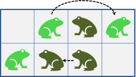
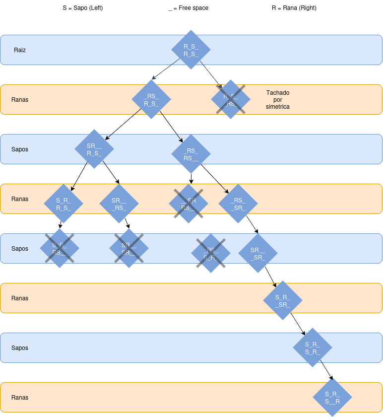
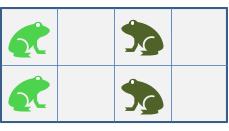

El juego de los sapos y las ranas. Alicia ha capacitado un grupo de ranas y Bruno un grupo de sapos para jugar el siguiente juego. Cada uno de los jugadores persuade por turno a una de sus criaturas para que se mueva una posición o salte sobre un rival a la siguiente posición libre.
Los sapos mueven solo hacia la izquierda y las ranas solo hacia la derecha. Pierde el jugador que tiene el turno de jugar y cuyo equipo no dispone de ningún batracio móvil (por ejemplo, cuando todos han llegado al extremo opuesto). Algunas jugadas válidas se muestran a continuación.

Rana
Fig. 1. Ejemplo de movidas válidas.


Aquí, los sapos son más oscuros que las ranas y además todos miran en la dirección hacia la que se pueden desplazar. En el caso de arriba, la rana saltó sobre el sapo para ocupar la primera posición libre. Si hubiera sido su turno, el sapo podría haber saltado sobre la rana. En el ejemplo de abajo, el sapo se desplazó una posición para ocupar la siguiente posición libre a la izquierda.

---
### A) Desarrolle el árbol de juego para el estado inicial que se muestra en la figura 2. No desarrolle el árbol completo; utilice alguno de los métodos de poda que se vieron en la exposición de experto correspondiente a esta UVA (por ejemplo, en el algoritmo del juego de los fósforos).

Ranas desplazan a la derecha.
	-  Avanzar 1 casilla a la derecha si esta vacia.
	- Saltar 1 casilla sobre un Sapo si la casilla siguiente esta vacia
Sapos desplazan a la izquierda
	- Avanzar 1 casilla a la izquierda si esta vacia.
	- Saltar 1 casilla sobre una rana si la casilla siguiente esta vacia.

### B) Estime aproximadamente la reducción de nodos explorados que se logra a través de la poda. Explique la razón de esto.
Sin poda, se estima que puede superar a 120 nodos, debido a que cada fila tiene aproxidamente tiene 8-12 estados alcanzables, y al combinar dos filas independientes. $(F1XF2=100)$
Con poda, al aprovechar que las dos filas son identidas, y se elimina la mitad de las ramas iniciales por simetria, y al evaluar las subfilas de forma independiente, los nodos se reproducen a aproxidamente 15-25 nodos. $(F1+F2$), en vez de $(F1*F2)$
El porcentaje de reduccion se estima de 60% a 75% ($((120/100)*25)-100$)
### C) Escriba el pseudocódigo para el desarrollo del árbol de este juego incluyendo la poda. Ingrese como parámetros cantidad de filas y posiciones iniciales de las ranas y los sapos. 
```
Estructura EstadoJuego:
    filas: Lista de Cadenas  // Ejemplo: ["R_S_", "R_S_"]
    turno: Jugador          // RANAS (Maximizador) o SAPOS (Minimizador)

TablaTransposicion = Diccionario()

Funcion ResolverJuego(filasIniciales, jugadorInicial):
    estadoInicial = CrearEstado(filasIniciales, jugadorInicial)
    resultado = AlfaBeta(estadoInicial, profundidad=10, alfa=-INFINITO, beta=+INFINITO, esTurnoRanas=(jugadorInicial == RANAS))
    Devolver resultado

Funcion AlfaBeta(estado, profundidad, alfa, beta, esTurnoRanas):
    movimientosValidos = GenerarMovimientos(estado, esTurnoRanas)
    Si movimientosValidos está vacío O profundidad == 0:
        // Si no hay movimientos, el jugador actual pierde
        Si movimientosValidos está vacío:
            Devolver (esTurnoRanas ? -1000 : +1000) // Pierde el jugador del turno actual
        Sino:
            Devolver EvaluarEstado(estado)
    llaveEstado = NormalizarYSerializar(estado) // Ordena filas para detectar simetrías de fila
    Si llaveEstado existe en TablaTransposicion:
        Devolver TablaTransposicion[llaveEstado]

    Si esTurnoRanas:
        maxEval = -INFINITO
        Para cada nuevoEstado en movimientosValidos hacer:
            eval = AlfaBeta(nuevoEstado, profundidad - 1, alfa, beta, Falso)
            maxEval = Max(maxEval, eval)
            alfa = Max(alfa, eval)
            Si beta <= alfa:
                Poda Alfa-Beta // Corte Alfa
                Break
        TablaTransposicion[llaveEstado] = maxEval
        Devolver maxEval
    Sino:
        minEval = +INFINITO
        Para cada nuevoEstado en movimientosValidos hacer:
            eval = AlfaBeta(nuevoEstado, profundidad - 1, alfa, beta, Verdadero)
            minEval = Min(minEval, eval)
            beta = Min(beta, eval)
            Si beta <= alfa:
                Poda Alfa-Beta // Corte Beta
                Break
        TablaTransposicion[llaveEstado] = minEval
        Devolver minEval

Funcion GenerarMovimientos(estado, esTurnoRanas):
    listaMovimientos = Lista()
    Para i desde 0 hasta CantidadDeFilas(estado) - 1 hacer:
        fila = estado.filas[i]
        
        Si esTurnoRanas:
            Para pos desde 0 hasta Longitud(fila) - 1 hacer:
                Si fila[pos] == 'R':
                    Si pos + 1 < Longitud(fila) Y fila[pos + 1] == '_':
                        nuevaFila = Mover(fila, pos, pos + 1)
                        AgregarNuevoEstado(listaMovimientos, estado, i, nuevaFila)
                    Si pos + 2 < Longitud(fila) Y fila[pos + 1] == 'S' Y fila[pos + 2] == '_':
                        nuevaFila = Mover(fila, pos, pos + 2)
                        AgregarNuevoEstado(listaMovimientos, estado, i, nuevaFila)
        Sino:
            Para pos desde 0 hasta Longitud(fila) - 1 hacer:
                Si fila[pos] == 'S':
                    // Avance simple
                    Si pos - 1 >= 0 Y fila[pos - 1] == '_':
                        nuevaFila = Mover(fila, pos, pos - 1)
                        AgregarNuevoEstado(listaMovimientos, estado, i, nuevaFila)
                    // Salto sobre Rana
                    Si pos - 2 >= 0 Y fila[pos - 1] == 'R' Y fila[pos - 2] == '_':
                        nuevaFila = Mover(fila, pos, pos - 2)
                        AgregarNuevoEstado(listaMovimientos, estado, i, nuevaFila)

    Devolver EliminarEstadosDuplicadosYSimetricos(listaMovimientos)
```
